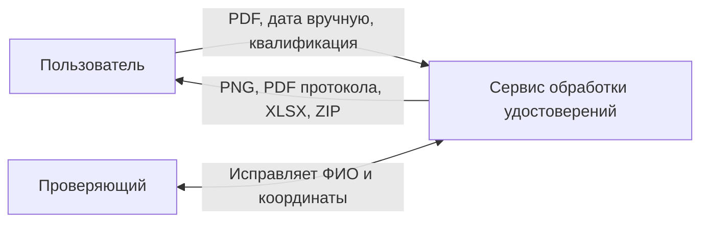
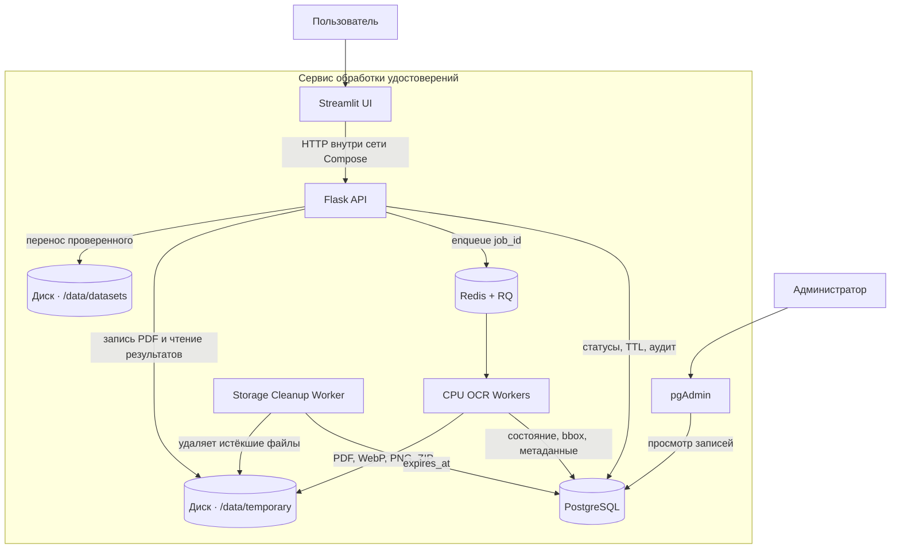
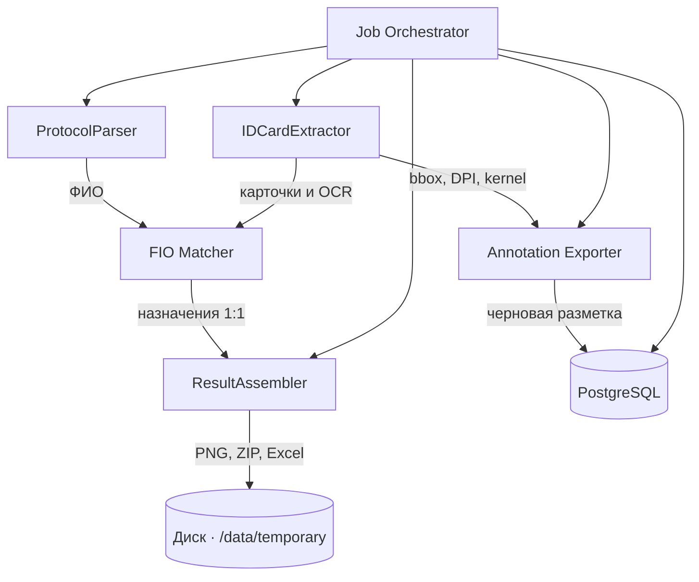
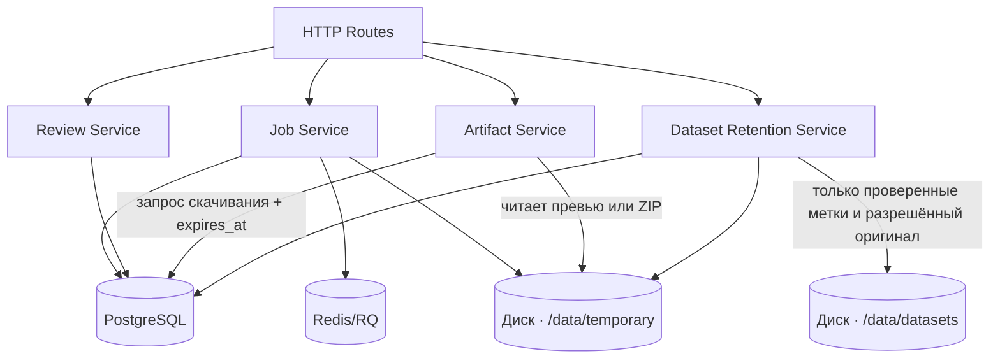
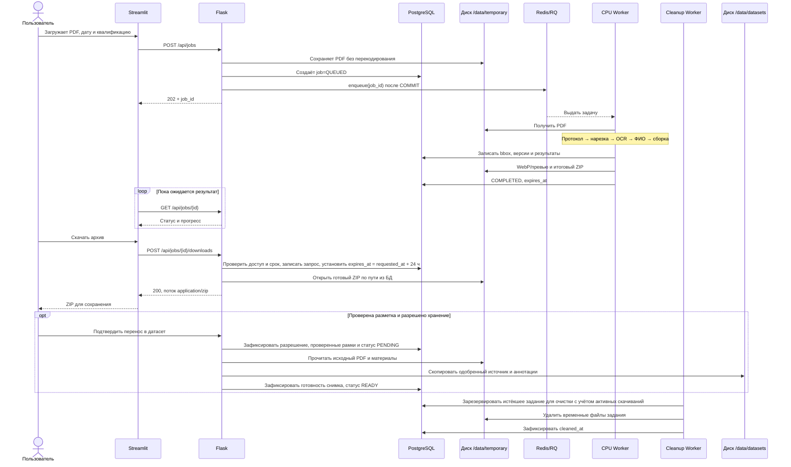

# C4-архитектура сервиса обработки удостоверений — v2

Проект для запуска через Docker Compose на одном сервере. Документы и результаты лежат в каталоге `./data` на диске сервера. PostgreSQL хранит записи о заданиях и файлах. Для просмотра этих записей предусмотрен pgAdmin.

## Архитектурные решения

1. **Не менять рабочую нарезку** (`IDCardExtractor`/OpenCV/автоподбор kernel) и сопоставление ФИО (`linear_sum_assignment`). Ручная дата окончания и квалификация передаются параметрами задания; даты в удостоверениях не распознаются.
2. **PostgreSQL** хранит состояния, координаты, относительные пути к файлам, контрольные суммы и историю исправлений. **Redis/RQ** передаёт воркеру идентификатор задания.
3. **Файловое хранилище** состоит из двух каталогов. В `./data/temporary` лежат исходники и результаты заданий, в `./data/datasets` — разрешённые к хранению исходники и проверенные аннотации. Docker Compose подключает каждый каталог отдельно. Пути в БД отсчитываются от общего корня `/data` внутри контейнеров, например `temporary/jobs/{job_id}/input/source.pdf`.
4. **Временные нарезки не хранятся бессрочно**; превью используют WebP с потерями, промежуточные изображения при необходимости WebP lossless. Итоговый ZIP для пользователя можно формировать с PNG, протоколом PDF и XLSX по существующему формату результата.
5. **Исходный PDF сохраняется без перекодирования**: он может уже содержать эффективно сжатые изображения. PDF (либо качественная страница) и одобренные bbox достаточно для воспроизводимой повторной нарезки. Если исходный PDF удалён, регенерация из координат невозможна.
6. **Разметка для обучения отделена**: `auto/draft` ≠ `human/verified`. Перенос в `datasets/` только после проверки и при разрешённом хранении документов с персональными данными. Постоянное хранение исходников не включается автоматически.

## C1. Контекст системы

## C2. Контейнеры

Flask и OCR-воркер видят один и тот же PDF по пути `/data/temporary/jobs/{job_id}/input/source.pdf`. Streamlit получает превью и архив через Flask. Каталог датасета подключён только к Flask, который проверяет право на перенос.

## C3. Компоненты CPU Worker

`Annotation Exporter` сохраняет подготовленные координаты в PostgreSQL. Экспорт в JSON/YOLO/COCO делается при необходимости и для подтверждённого набора данных; не требуется дублировать все страницы как PNG, если хранится исходный PDF.

## C3. Компоненты Flask API

## Последовательность обработки и хранения

При запросе архива Flask фиксирует `download_events.requested_at`, обновляет `jobs.last_download_requested_at` и `jobs.expires_at`. На время передачи действует `download_lease_until`. При длительной передаче Flask продлевает этот срок. Событие в журнале означает, что пользователь запросил архив.

## Форматы и сроки хранения (предлагаемые значения)

| Вид данных | Формат / путь | Хранение | Особенности |
|---|---|---|---|
| Исходный PDF задания | `temporary/jobs/{job_id}/input/source.pdf` | До окончания срока задания | Хранить без потерь и перекодирования |
| Временные нарезки | `temporary/jobs/{job_id}/revisions/{revision}/work/*.webp` | До очистки задания | WebP без потерь, можно пересоздать из PDF |
| Превью для Streamlit | `temporary/jobs/{job_id}/revisions/{revision}/preview/*.webp` | До очистки задания | WebP с потерями для просмотра |
| Протокол и пользовательский экспорт | `temporary/jobs/{job_id}/revisions/{revision}/output/` | До очистки задания | ZIP содержит карточки в PNG, страницы протокола в PDF и отчёт XLSX |
| Исходник для подтверждённого датасета | `datasets/sources/{dataset_id}/source.pdf` | По отдельной политике | Только при разрешении и проверке; возможно вместо PDF качественные страницы |
| Подтверждённые аннотации | PostgreSQL + `datasets/annotations/{dataset_id}/...json` | По отдельной политике | С координатами, версией, автором и статусом `verified` |

По умолчанию временные файлы доступны **7 суток после завершения задания**. Каждый запрос архива устанавливает новый срок — **24 часа от этого запроса**. Эти интервалы настраиваются. Streamlit показывает пользователю текущее значение `expires_at`. Для ошибочных и отменённых заданий предусмотрен отдельный срок, например 24 часа.

Процесс очистки периодически выбирает в PostgreSQL задания с истёкшим `expires_at`. Под той же блокировкой записи, которую использует Flask при выдаче архива, он проверяет `download_lease_until` и отмечает задание для удаления. Затем удаляет каталог этого задания в `/data/temporary/jobs` и фиксирует `deleted_at` у файлов и `cleaned_at` у задания. После сбоя очистку можно повторить, в том числе если часть файлов уже удалена. Каталог `/data/datasets` имеет собственную политику хранения.

## Повторное получение карточек из оригинала

Страницы нумеруются с 1. Координаты рамки — `[x1,y1,x2,y2]` в пикселях страницы, отрендеренной при 150 DPI с учётом поворота в PDF. Правый и нижний края исключены. В БД записаны хеш исходника, размер растра, поворот, параметры выбранного ядра OpenCV, исходный контур, фактическая рамка вырезки и версия алгоритма. Для правки воркер рендерит исходную страницу с тем же DPI и применяет сохранённую рамку.

Если исходник в `datasets/` не перенесён и временный PDF удалён, восстановить карточки невозможно. В интерфейсе показывать `EXPIRED` или предлагать повторную загрузку PDF, а не обещать восстановление без исходного файла.

## PostgreSQL: уточнения к модели

| Таблица | Основные поля / изменения |
|---|---|
| `users` | Пользователь, роль, права |
| `jobs` | `id`, `owner_id`, `status`, `progress`, ручная дата/квалификация, `completed_at`, `expires_at`, `last_download_requested_at`, `cleaned_at`, `pipeline_version` |
| `documents` | `job_id`, имя загрузки, `source_relative_path`, `sha256`, `page_count` |
| `pages` | `job_id`, `page_number`, размер, DPI, поворот, выбранное ядро OpenCV и `preview_relative_path` |
| `cards` | `job_id`, `card_no`, номер страницы, `bbox`, исходный контур, предупреждения, `crop_relative_path`, вручную назначенная строка протокола |
| `protocol_rows` | Текст OCR, ФИО, сомнительная строка; привязка к странице протокола |
| `matches` | Назначение card ↔ строка протокола, score, правки |
| `annotations` | `job_id`, `card_no`, `geometry`, `source=auto/human`, `status=draft/verified`, `annotator`, `version`, `verified_at` |
| `corrections` | Номер карточки и ревизии, автор, время, прежние и новые значения |
| `artifacts` | `job_id`, `revision`, `relative_path`, `kind`, `media_type`, `sha256`, `deleted_at`. Срок определяется заданием |
| `download_events` | `job_id`, `user_id`, `artifact_id`, `requested_at`, `download_lease_until`, исход запроса на выдачу архива |
| `datasets` | Владелец, основание хранения, срок/политика, статус ревью, относительные пути к разрешённым оригиналам и аннотациям |

После удаления временных файлов в PostgreSQL можно сохранить только техническую историю и необходимые метаданные; ФИО/текст OCR/координаты и прочие персональные данные тоже должны подчиняться отдельной согласованной политике удаления и минимизации.

## API MVP (обновлённые маршруты)

| Метод | Маршрут | Назначение |
|---|---|---|
| `POST` | `/api/jobs` | PDF, ручная дата и квалификация, страницы протокола; ответ `202 + job_id` |
| `GET` | `/api/jobs` | Только задания текущего пользователя |
| `GET` | `/api/jobs/{id}` | Статус, прогресс, `expires_at`, ошибки |
| `GET` | `/api/jobs/{id}/results` | ФИО, карточки, статусы проверки, доступные превью |
| `PATCH` | `/api/jobs/{id}/corrections` | Ручная правка ФИО/bbox и аудит |
| `POST` | `/api/jobs/{id}/downloads` | Проверить доступ, отметить запрос, обновить TTL и вернуть ZIP в теле ответа (`application/zip`) |
| `POST` | `/api/jobs/{id}/annotations/verify` | Подтвердить координаты для будущего обучения |
| `POST` | `/api/jobs/{id}/dataset-promotion` | Только при разрешении перенести источник и проверенные метки в `datasets` |
| `GET` | `/health` | Healthcheck |

## Асинхронность, устойчивость и безопасность

- Один RQ worker выполняет одну задачу за раз; число CPU worker ограничивается RAM, ядрами и памятью EasyOCR. Старт — 1–2 worker после измерений. Streamlit запрашивает статус, тяжёлый OCR в Flask не выполняется.
- Flask проверяет права пользователя на задание перед выдачей файла. Сервер сам формирует путь из идентификатора задания и вида файла и проверяет, что разрешённый путь находится внутри каталога этого задания. Воркер пишет архив во временный файл в каталоге назначения и атомарно переименовывает его до фиксации статуса `COMPLETED`.
- PostgreSQL хранит состояния `QUEUED/RUNNING/COMPLETED/FAILED/DELETING/EXPIRED`. Признак `needs_review` относится к конкретной карточке.
- Flask передаёт задание в RQ после фиксации в PostgreSQL. Процесс очистки также проверяет ожидающие и прерванные задания. Если воркер потерял соединение и в очереди отсутствует текущая версия задания, процесс ставит её повторно. Блокировка PostgreSQL на идентификатор задания и проверка версии сериализуют попытки. Воркер публикует файлы версии и фиксирует результаты одной транзакцией.
- Резервное копирование PostgreSQL и каталога `datasets` учитывает связи записей с файлами. Права на резервные копии и сроки их хранения задаёт организация.

## Развёртывание

На одном Docker-хосте работают `streamlit`, `flask`, `postgres`, `redis`, `rq-worker`, `cleanup-worker` и `pgadmin`. Каталоги с файлами лежат рядом с Compose-файлом и подключаются через bind mounts. При пересоздании контейнеров документы и результаты сохраняются на диске хоста.

| Каталог на хосте | Путь в контейнере | Сервисы с доступом на чтение и запись |
|---|---|---|
| `./data/temporary` | `/data/temporary` | `flask`, `rq-worker`, `cleanup-worker` |
| `./data/datasets` | `/data/datasets` | `flask` |

Для PostgreSQL и настроек pgAdmin предусмотрены отдельные постоянные тома. В pgAdmin заранее настроено подключение к `postgres:5432` по внутренней сети Compose. Для просмотра данных используется роль PostgreSQL с правом чтения. Локальный порт pgAdmin публикуется как `127.0.0.1:5050:80`. Пароли задаются через локальный `.env`.

Дополнительные OCR-воркеры на этом же хосте используют тот же каталог. Для запуска воркеров на нескольких серверах потребуется общая файловая система, доступная им по одному пути.

В этом документе представлены диаграммы C4 в Mermaid. Для отдельной редактируемой модели C1, C2, C3 OCR Worker и C3 Flask API предусмотрен файл `architecture_c4_credential_service_v2.dsl`.
