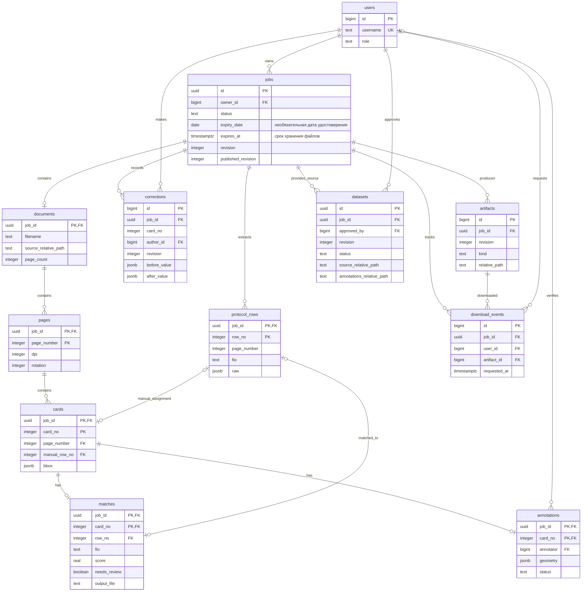

# Связи таблиц PostgreSQL

ER-диаграмма базы `ocr` по [SQL-миграциям](migrations/). На диаграмме показаны ключевые поля и фактические ограничения внешних ключей.

Для загрузки в редактор Mermaid используйте [database_er.mmd](database_er.mmd). В этом файле только код диаграммы.

- Карточка привязана к странице по паре `(job_id, page_number)`. Сопоставление и разметка ссылаются на карточку по паре `(job_id, card_no)`.
- Для ручного назначения используется `cards.manual_row_no`, для итогового сопоставления — `matches.row_no`. Оба поля могут быть пустыми. В каждой из этих таблиц ненулевая пара с `job_id` уникальна.
- `protocol_rows.page_number` и `corrections.card_no` хранят номер страницы и карточки соответственно. Для этих полей в базе нет отдельных внешних ключей.
- Артефакт уникален по `(job_id, revision, kind)`. PDF, изображения и ZIP лежат на диске, а в базе находятся пути к ним.
- Служебная таблица `schema_migrations` хранит историю применения миграций и не участвует в связях.
